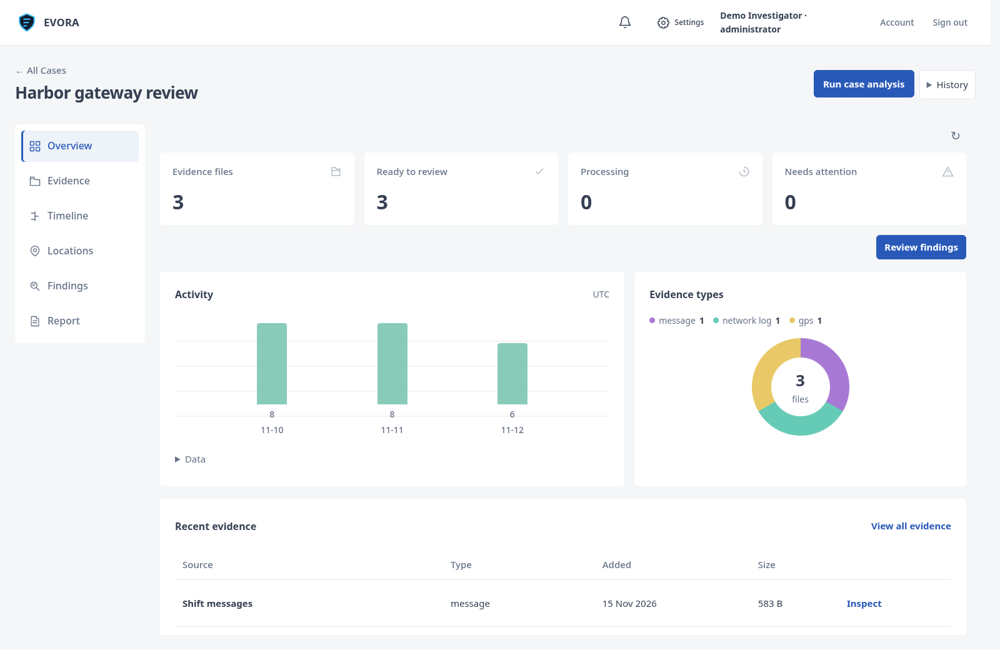
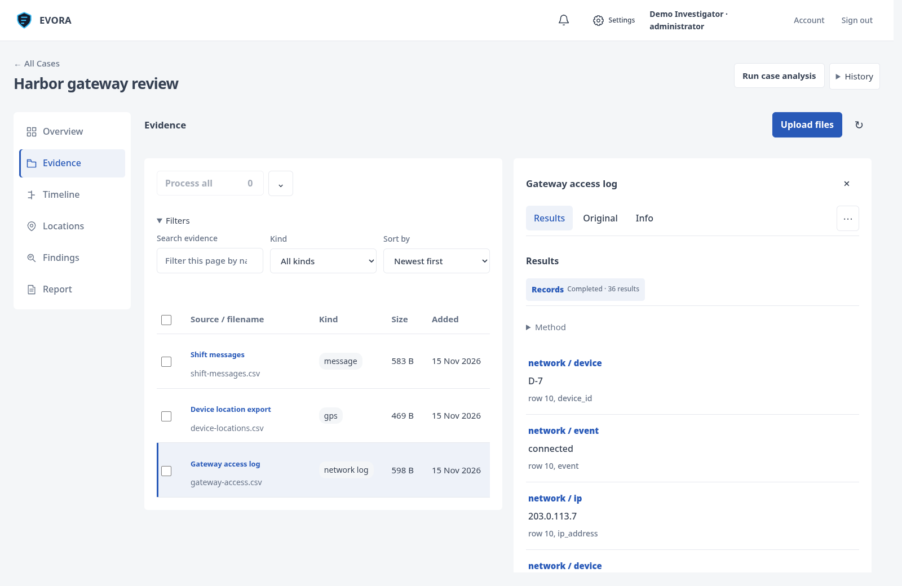
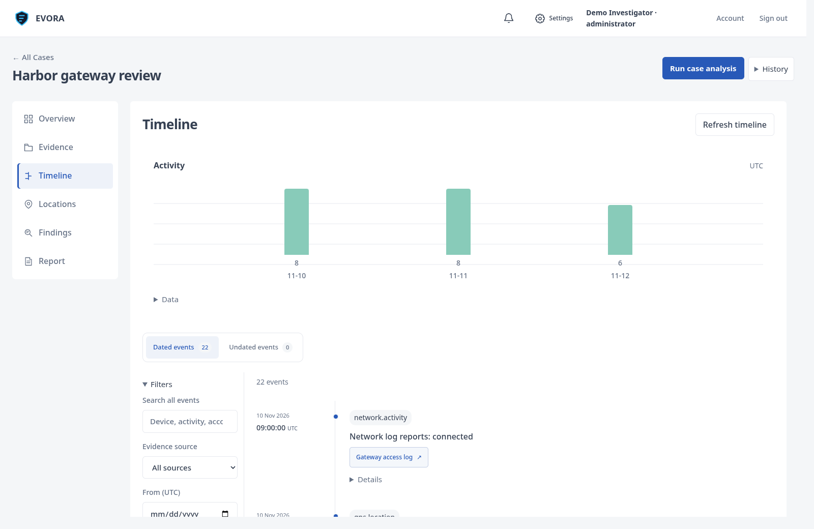
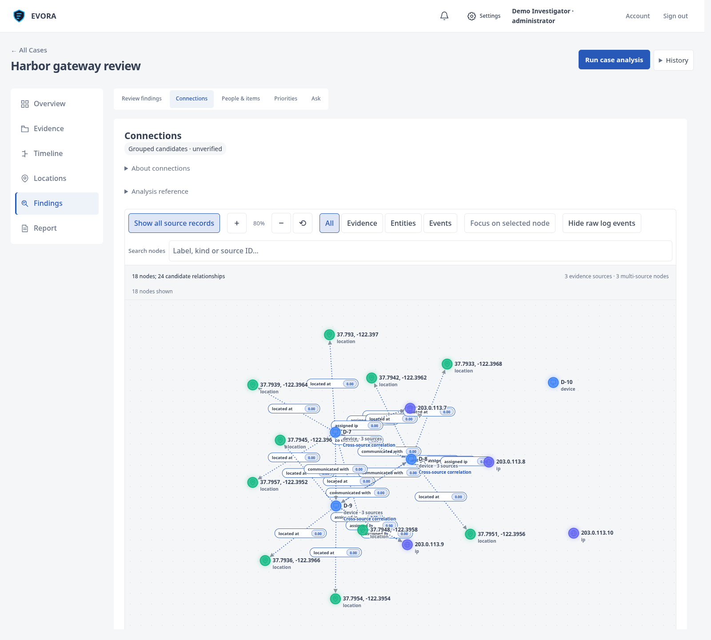
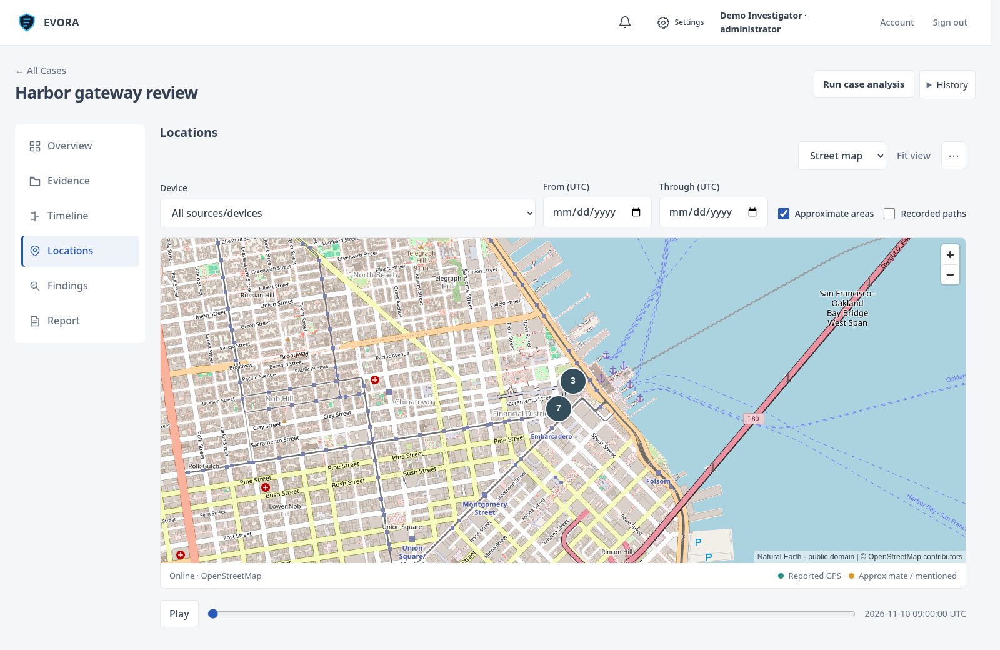
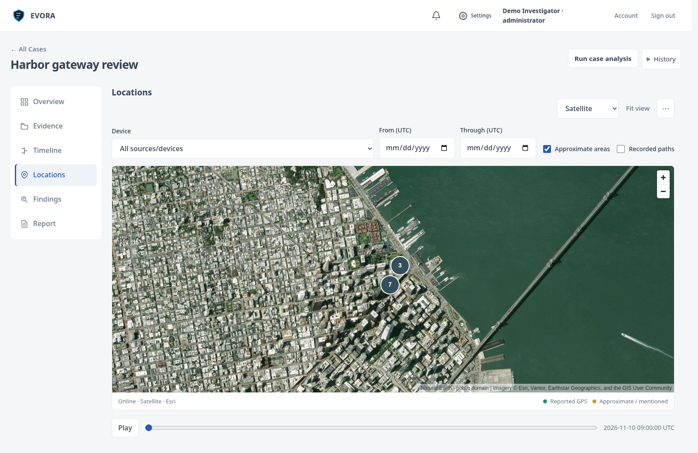
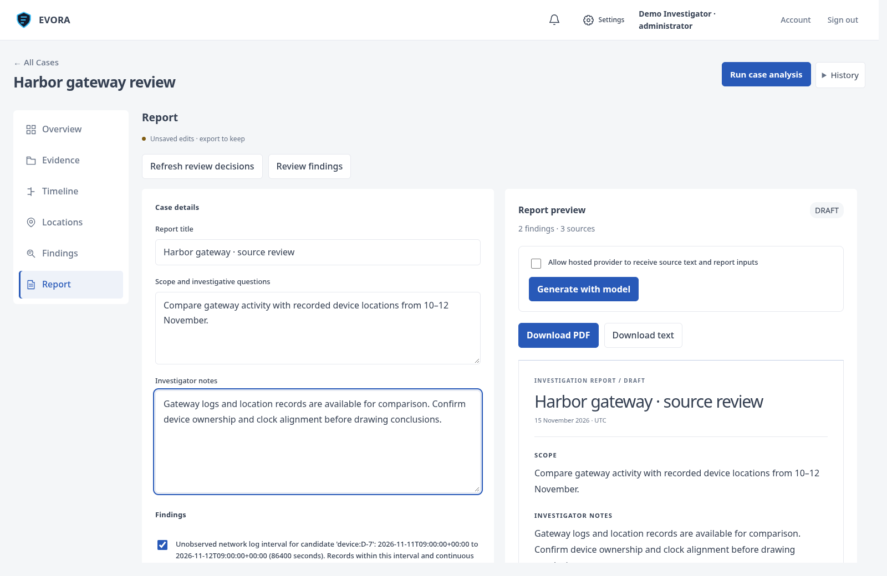
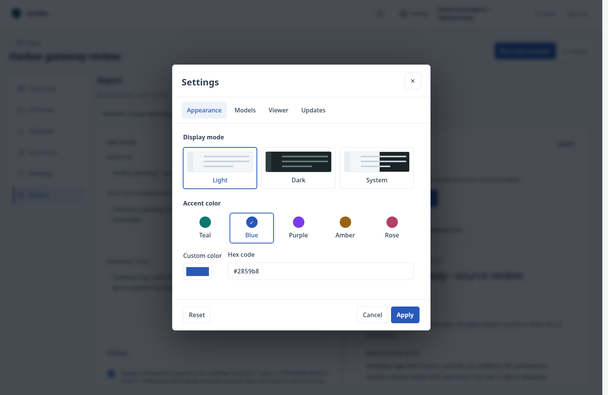

# EVORA

A desktop workspace for organizing digital evidence and following its connections.

Bring documents, images, audio, video, messages, network logs, and GPS records into a case. Inspect extracted results, compare events, explore relationships, and return to the original source from your findings.

[Download EVORA](https://github.com/yazh-07/EVORA/releases/latest) · [Documentation](#documentation) · [Contribute](docs/development.md)

*Screenshots use a synthetic training case.*

## Get started

EVORA is available for **Windows x64** and **Linux x86_64**.

| Platform | Download | Install |
| --- | --- | --- |
| Windows | [Windows setup](https://github.com/yazh-07/EVORA/releases/latest/download/EVORA-Setup-Windows-x64.exe) | Run the installer, then open EVORA. |
| Linux | [Linux package](https://github.com/yazh-07/EVORA/releases/latest/download/evora-linux-x86_64.tar.gz) | Extract the archive and run `bash install.sh` inside the extracted `evora` folder. |

Create a local administrator account on first launch, then create a case and add your evidence. Updates are available in **Settings → Updates**.

## Work through a case

1. **Add evidence.** Upload individual files or a batch. EVORA records a SHA-256 hash and preserves the original files.
2. **Process sources.** Extract supported records and inspect the results alongside the original evidence.
3. **Compare what happened.** Use the timeline, relationship graph, and location map to explore the case.
4. **Review and report.** Review findings, ask questions with source references, and export a report.

### Evidence and results

Keep source files, extracted records, and processing history together. Open a record to inspect where it came from.

### Timeline

Compare recorded events and filter by time or source.

### Connections

Explore links between evidence and extracted entities. Move nodes and inspect the records behind a connection.

### Locations

View recorded GPS positions on street or satellite maps. Recognized place mentions are marked as approximate locations. Street View opens available imagery in your browser.

### Reports

Choose findings, add your notes, and export PDF or text reports. Model-assisted drafts can be reviewed and edited before export.

## Make it your workspace

Choose light, dark, or system appearance and customize the accent color. Local accounts provide administrator, investigator, and reviewer roles with case access controls.

Windows keeps EVORA running in the system tray when you close its window. Click the tray icon to reopen it, or choose **Exit EVORA** to quit.

## Models and connectivity

Use Ollama for local AI or configure a supported hosted provider in Settings. Image, audio, and video processing depend on the selected models and installed processing tools.

EVORA is available only on this machine by default. **Settings → Advanced** lets you make it available on a trusted local network and choose its port; restart EVORA to apply network changes.

Hosted models and online maps require a network connection. Offline maps and local model options are available. Review model results against the linked evidence.

## Documentation

- [Accounts and access](docs/local-accounts.md)
- [Database encryption and recovery](docs/database-encryption.md)
- [Model-assisted reports](docs/model-reports.md)
- [Updates and recovery](docs/incremental-updates.md)
- [Bundled graph runtime](docs/bundled-graph.md)
- [Developer setup](docs/development.md)
- [Architecture](docs/ARCHITECTURE.md) and [API reference](specs/openapi.yaml)

## Contributors

Built by [whale2186](https://github.com/whale2186), [yazh-07](https://github.com/yazh-07), [JebasJ](https://github.com/JebasJ), and [sharmelas-925](https://github.com/sharmelas-925).

Bug reports, documentation improvements, and contributions are welcome through [GitHub issues](https://github.com/yazh-07/EVORA/issues) and pull requests.
