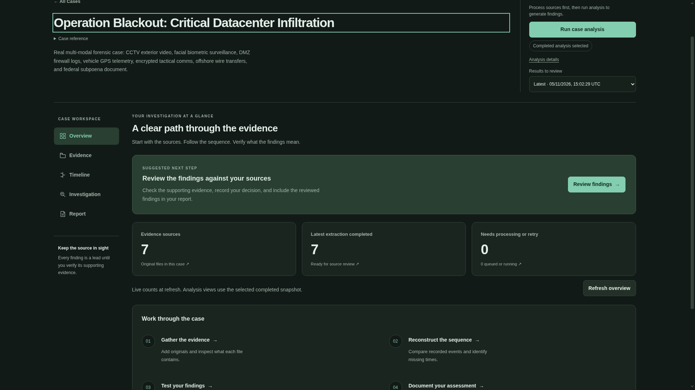
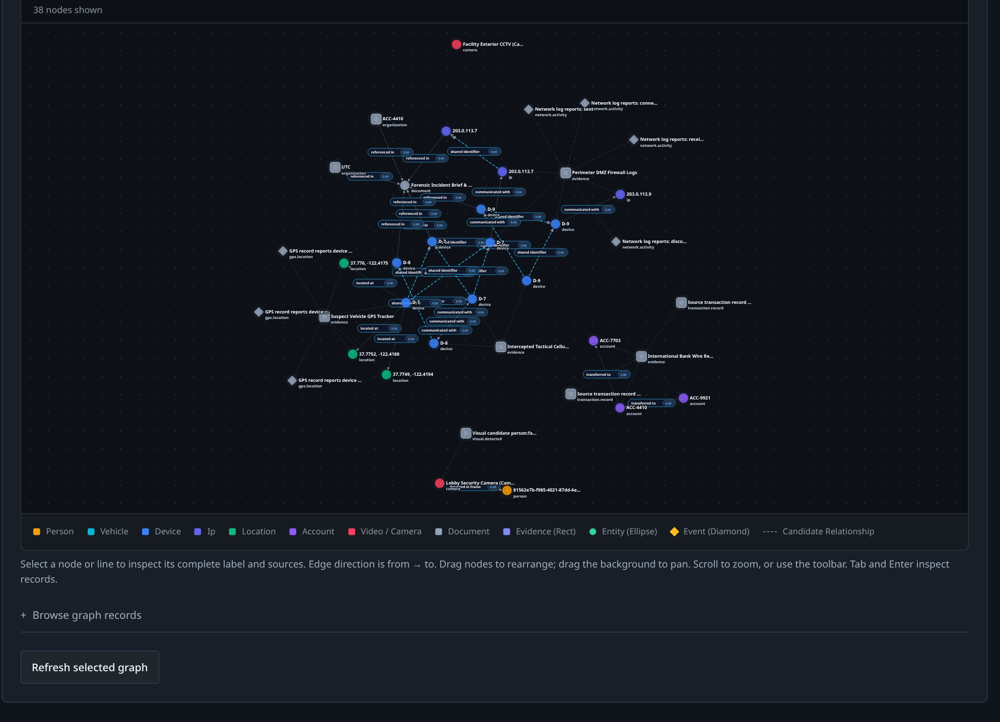
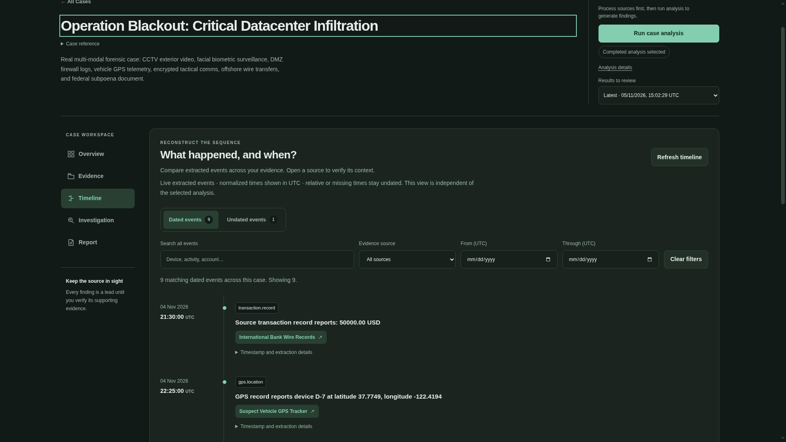
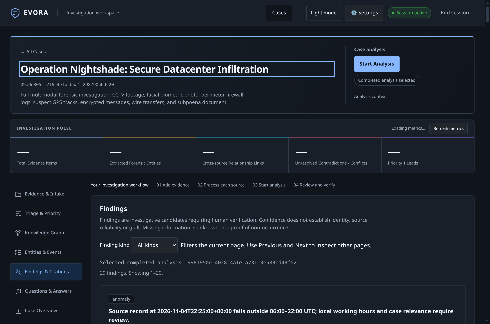
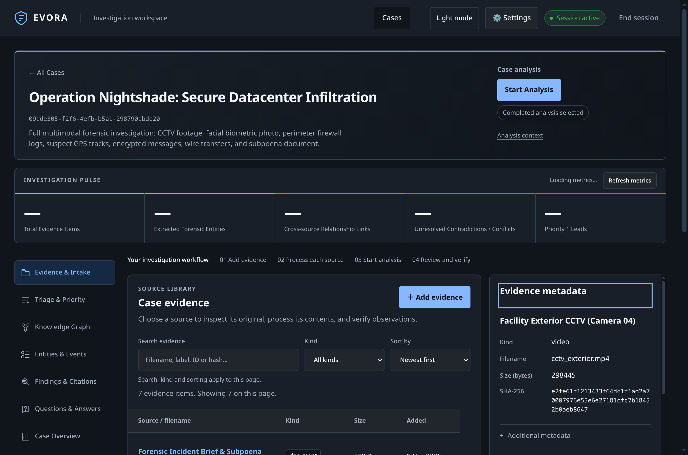
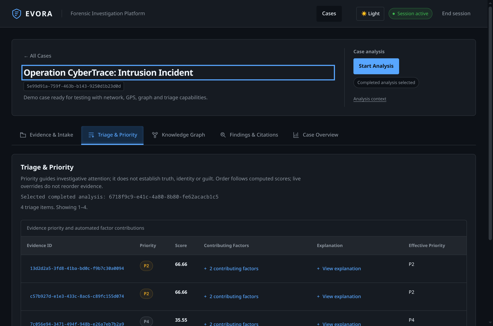
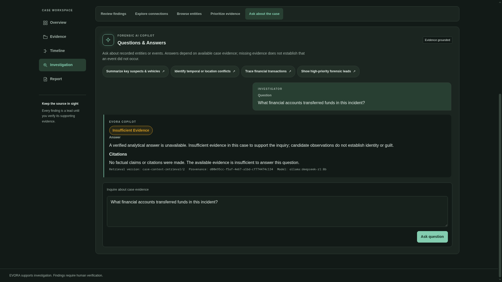
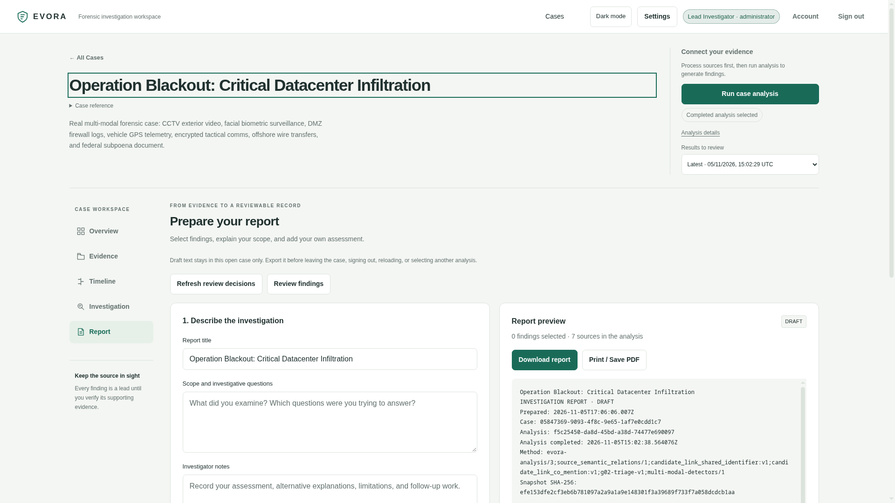

# EVORA — Forensic Evidence Fusion & Adaptive Investigation Platform

[](https://github.com/yazh-07/EVORA/actions/workflows/contract.yml)


EVORA is an open-source, AI-assisted multimodal forensic evidence fusion and investigation-support platform. It brings evidence intake, extraction, relationship discovery, and explainable prioritization into one investigation workspace, with strict source-to-byte traceability throughout. Investigators can follow a candidate relationship back through its supporting observations and source locators to the original artifact and its SHA-256 hash.

The platform is built around a practical question: **what should an investigator examine next, and why?** Its pipeline automates supported ingestion and extraction, connects observations across sources, and explains the factors behind each evidence priority. Original bytes, processing outputs, and historical analysis snapshots remain preserved as the investigation develops.

EVORA supports professional judgment. Candidate relationships, extracted statements, and priority scores require human verification; they do not establish identity, guilt, or admissibility.

## Current capabilities & updated features

EVORA organizes each case into five primary sections:

| Section | Capabilities |
| --- | --- |
| **Overview** | Check case readiness across evidence sources, review suggested next steps, and inspect the AI Forensic Executive Brief. |
| **Evidence** | Batch upload via drag-and-drop with auto type detection, SHA-256 verification, and UTF-8 plain text/media inspection. |
| **Timeline** | Chronologically compare extracted events across sources with normalized UTC ordering and date range filters. |
| **Investigation** | Human review of findings, interactive knowledge graph (40 nodes, 35 relationships), candidate entities, and grounded AI Copilot Q&A. |
| **Report** | Generate and review model-assisted narratives, then download formatted A4 PDF reports or plain text with findings, evidence manifests and source references. |

### Offline Workstation & Local Accounts
- **Standalone execution:** Start with `python -m backend.run` on `127.0.0.1:8000` with zero internet required.
- **Local credentials:** Argon2id password hashing, HttpOnly session cookies, role-based access (Administrator, Investigator, Reviewer), and single-use recovery code.
- **Local AI assistance:** Direct Ollama integration (e.g. `llama3.1:8b`) with strict loopback isolation and grounded evidence citations.

See [NEW_UPDATE_FEATURES.md](docs/NEW_UPDATE_FEATURES.md) and [docs/local-accounts.md](docs/local-accounts.md) for full implementation details.

## Screenshots

### 1. Case Overview & Forensic Executive Brief


### 2. Forensic Knowledge Graph Visualization


### 3. Chronological Case Timeline


### 4. Findings Review & Human Verification Controls


### 5. Evidence Intake & Source Verification


### 6. Adaptive Triage & Priority Scoring


### 7. AI Copilot Evidence Q&A


### 8. Investigative Report Generator & PDF Export


Open a completed analysis and choose **Report**. Set the scope, select findings, and choose **Generate with model** using your connection from Settings. Review and edit the draft, confirm investigator review, then choose **Download PDF**. The file downloads directly with a cover page, narrative sections, findings, evidence tables, citations and numbered pages. PDF export runs locally with bundled fonts; model generation follows your configured provider and sharing consent. See [Model reports](docs/model-reports.md) for coverage, provenance and limitations.

## Core architecture & investigation pipeline

The React application communicates exclusively with the FastAPI backend. Only the backend accesses SQLite, Neo4j, and the private original vault. SQLite is authoritative; Neo4j is a rebuildable relationship projection.

1. **Ingestion & vault.** Evidence receives an ID, cryptographic SHA-256 integrity information, and private original storage. Append-only SQLite audit trails record authorized activity without copying source contents into public logs.
2. **Multimodal normalization.** Supported adapters retain raw values and source locators while applying deterministic UTC timestamp and coordinate normalization. Candidate entity and event resolution connects compatible observations without asserting verified identity.
3. **Knowledge graph projection.** Validated graph snapshots are published in SQLite without requiring Neo4j. If an external projector is explicitly configured, it must pass verification before completion. Failed or partial output remains hidden.
4. **Adaptive triage scoring.** The versioned [G02 mathematical policy](backend/triage/policy.py) defines relevance, connectivity, corroboration, temporal proximity, and other factors. The integrated initial scorer uses relevance and connectivity; remaining factors enter as their producers are integrated. Available weights are normalized explicitly, and evidence without supporting observations remains unscored. Scores express investigative priority, with separate treatment of extraction confidence, source reliability, corroboration, and uncertainty.
5. **Explainable findings.** Grounded factor explanations expose the scoring basis. Findings cite supporting observations and their source locators. Counterfactual sensitivity helpers show how removing a candidate entity changes a diagnostic score without rewriting published history.

See the [architecture](docs/ARCHITECTURE.md), [contract policies](docs/CONTRACTS.md), and [design system](DESIGN.md) for further detail.

## Technology stack

| Layer | Technology | Role |
|---|---|---|
| Investigator workspace | React 19, TypeScript 5.9 | Case, evidence, graph, findings, and triage views |
| Frontend tooling | esbuild, Node.js 22, npm 12 | Development server, tests, and production build |
| HTTP backend | Python 3.14, FastAPI, Pydantic, Uvicorn | Authorized case APIs and processing/analysis lifecycle |
| Authoritative persistence | SQLite | Metadata, immutable outputs, snapshots, results, and audit |
| Graph projection | Neo4j 5.26 Community, Python driver 6.4.1 | Versioned case/run relationship partitions |
| Evidence storage | Private filesystem vault | Preserved original bytes and source hashes |
| Local text extraction | spaCy, pinned English model | Candidate text entities in supported processing components |
| API contract | OpenAPI 3.1, openapi-typescript | Shared schemas and generated TypeScript declarations |

Exact dependency pins are in [requirements.txt](requirements.txt), [frontend/package.json](frontend/package.json), and the frontend lockfile. The setup baseline is Python **3.14.8**, Node.js **22.23.3**, and npm **12.2.0**.

## Quickstart & getting started

Run the following commands from the repository root. The local demo uses synthetic identities and a transactional Neo4j test double, alongside real FastAPI, SQLite, processing, and analysis code. Use the committed synthetic fixtures for this demo.

### Backend setup

Use Python **3.14.8**: the local text model verifies the exact runtime, including the Python patch version. Create and activate the environment, then install the pinned dependencies:

```sh
python3.14 -m venv .venv
source .venv/bin/activate
python -m pip install -r requirements.txt
python -m pip check
```

On Windows, create the environment with `py -3.14 -m venv .venv` and activate it with `.venv\Scripts\Activate.ps1` in PowerShell. Installation includes the pinned public spaCy English model; model downloads require network access during setup.

### Frontend setup

With the pinned Node.js and npm versions available:

```sh
npm --prefix frontend ci
```

### Run the local demo server

Build the frontend for the same origin as the demo API, then start the supplied loopback server:

```sh
export EVORA_API_BASE_URL=http://127.0.0.1:8766
npm --prefix frontend run build
mkdir -p storage/demo
python frontend/test/serve-cases.py --database storage/demo/cases.sqlite3 --port 8766
```

In PowerShell, set `$env:EVORA_API_BASE_URL = 'http://127.0.0.1:8766'` and create the directory with `New-Item -ItemType Directory -Force storage/demo` before running the same build and server commands.

Open **http://127.0.0.1:8766** and enter the demo session token **`u02-synthetic-one`**. Create a case, upload [network.csv](fixtures/synthetic-case/network.csv) as network evidence or [gps.csv](fixtures/synthetic-case/gps.csv) as GPS evidence, and explicitly start processing. Inspect the observations, then start analysis to explore the graph, findings, and triage explanations. The second demo token, `u02-synthetic-two`, provides a separate investigator identity for access-isolation checks.

This server is a local test/demo harness. Its fixed tokens and graph double are not production authentication or a live Neo4j deployment. A backend deployment must supply an authorized token verifier; the default application factory rejects tokens. See [backend setup and graph configuration](backend/README.md) for live Neo4j configuration and optional integration checks.

For frontend development, `npm --prefix frontend run dev` serves the workspace at `http://127.0.0.1:5173`. `EVORA_API_BASE_URL` is read at build/start time; the demo above serves the UI and API together.

### Run tests

With the backend environment activated and frontend dependencies installed:

```sh
npx --yes @redocly/cli@2.57.0 lint specs/openapi.yaml
npx --yes @redocly/cli@2.57.0 bundle specs/openapi.yaml --output /tmp/evora-openapi.json
EVORA_CONTRACT_BUNDLE=/tmp/evora-openapi.json python -W error::ResourceWarning -m unittest discover -s backend/tests -v
npm --prefix frontend run check:api
npm --prefix frontend run typecheck
npm --prefix frontend run test
npm --prefix frontend run build
npx --yes @google/design.md@0.4.0 lint DESIGN.md
git diff --check
```

On Windows, choose a bundle path under `$env:TEMP` and set `$env:EVORA_CONTRACT_BUNDLE` to that path before running unittest. Default backend tests skip opt-in live Neo4j checks; enabling `EVORA_NEO4J_INTEGRATION=1` requires a configured disposable Neo4j instance. Default passing results do not establish live graph connectivity.

For the real HTTP/UI-controller integration smoke, run `node frontend/test/cases.integration.mjs` after tests and build. Set `EVORA_TEST_PYTHON` to your environment's Python executable if it is outside `PATH`. This smoke uses synthetic identities and an explicit graph double by default.

## API reference

[specs/openapi.yaml](specs/openapi.yaml) is the authoritative HTTP contract, version **0.3.0**. It describes case and evidence management, original downloads, processing and observation inspection, entities/events, analysis, graph/findings/triage, review, question answering, audit, and transcript revisions. Some operations describe features still under development; the specification alone does not establish implementation.

Implemented endpoints use the `/api/v1` prefix and bearer authentication. Case-scoped access checks protect sources and results. Invalid input maps to the shared `400 ApiError`; unauthorized case resources are concealed behind `404` responses. Processing and analysis starts use idempotency keys; analysis starts have no request body. Consumers pin a completed `analysis_run_id` across graph, findings, triage, and every result page.

Generate frontend declarations with `npm --prefix frontend run generate:api`; validate freshness with `npm --prefix frontend run check:api`. Contract policies and immutable snapshot semantics are documented in [docs/CONTRACTS.md](docs/CONTRACTS.md).

## Team & contributors

EVORA is developed by [whale2186](https://github.com/whale2186), [yazh-07](https://github.com/yazh-07), [JebasJ](https://github.com/JebasJ), and [sharmelas-925](https://github.com/sharmelas-925).

Contributions should preserve source provenance, case isolation, immutable history, and explainable results. Use synthetic or publicly permitted fixtures and include behavior tests for changed APIs or processing logic.

Model-assisted report generation, source checks, sharing controls and export behavior are documented in [Model reports](docs/model-reports.md).

The local SQLite database is encrypted and unlocks with the account password. See [Database encryption](docs/database-encryption.md) for migration, recovery and backup requirements.
